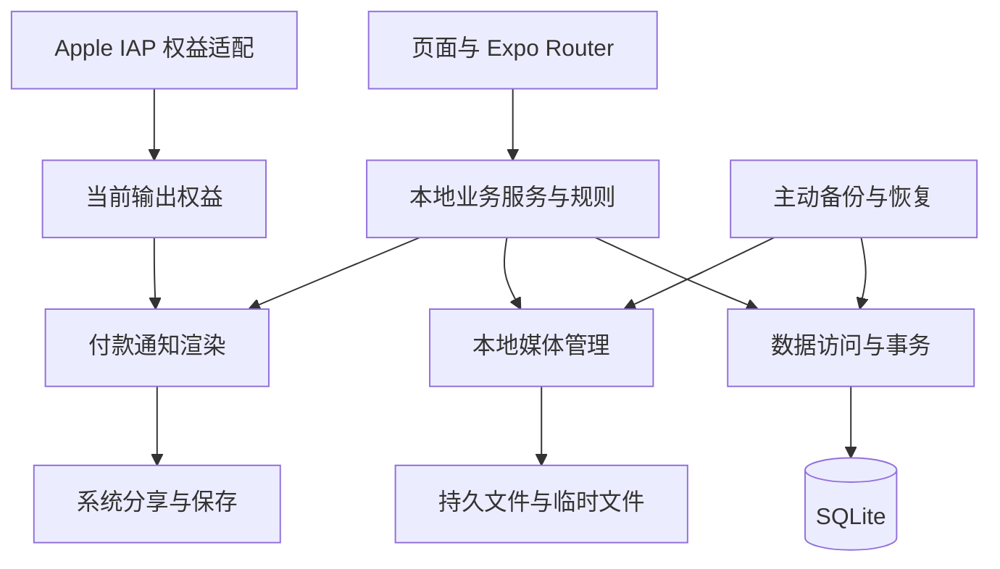

# OrderMori — Technical Architecture Design v0.1

| 文档信息 | 内容 |
| --- | --- |
| 版本 / 查询日期 | v0.1 / 2026-10-28（Asia/Hong_Kong） |
| 状态 | Review Draft / Not Implemented |
| 阶段 | Phase 0E-1：架构设计与关键技术验证计划 |
| 产品依据 | [PRD v1.1](./PRD.md)、[UI_DIRECTION v1.0](./UI_DIRECTION.md)，两者继续为 Review Draft |
| 工程命名依据 | [品牌基线](../ORDERMORI_BRAND_BASELINE_v1.md)：OrderMori / ordermori |
| 仓库基线 | main；本地 HEAD、origin/main 及查询到的远程 HEAD 均为 dacf7963750471c25fcc67c8f02539907523c174；开始时 CLEAN |
| 辅助材料 | 当前仓库未找到 OrderMori_UI_HANDOFF_v0.1.md，未读取或推断其内容 |
| 配套计划 | [TECH_SPIKE_PLAN.md](./TECH_SPIKE_PLAN.md)：Planning / Not Executed |

本轮仅创建两份 Markdown 文档；没有工程、依赖安装、数据库、Migration、App 或 Spike 代码。下文的模块名、实体、目录和流程都是设计建议，不是现有实现。PRD 优先；本轮另已确认单店铺 MVP、预留数据归属，不等于授权多店铺功能。

证据使用以下分类，不能互相替代：

| 标记 | 含义 |
| --- | --- |
| P | 用户 / PRD 已确认的产品规则 |
| A | 已查到官方或库维护者文档中的 API / 版本声明，仅证明文档存在 |
| R | 推荐但尚未构建、安装或测试的方案 |
| H | 必须通过实际构建、真机或故障注入验证的假设 |
| U | 尚待用户决定或后续技术验证后冻结的事项 |

## 1. 总体架构与模块边界

**R：单一 React Native + Expo + TypeScript 客户端，SQLite 为业务事实来源，文件系统保存实际图片。** UI 不直接写数据库，不从分享回调修改付款状态；没有业务远程 API、云数据库、Supabase、微服务、账号系统或依赖注入框架。

| 边界 | 职责 | 不承担的职责 |
| --- | --- | --- |
| UI 与导航 | 两个主要 Tab 的候选结构、订单表单、商品 Sheet、预览、设置、购买反馈；本地语言词典与界面状态 | 不持有另一份独立订单数据库，不用按钮禁用代替业务校验 |
| 业务服务 | OrderService、DraftService、ProductService、PaymentConfigService；金额、三维状态、快照、复制、额度及输出资格 | 不自动核实到账、自动退款、发送给指定联系人 |
| 数据访问 | 少量按业务聚合组织的 Repository、参数化查询、事务、版本迁移入口、首页查询 | 不先引入 ORM、全局状态大框架或通用查询平台 |
| 本地文件管理 | 导入、持久副本、哈希、相对引用、完整性检查、无引用临时资源回收 | 不把相册 URI 当长期备份，不解析或生成 PayMe 支付码 |
| PNG 渲染 | 不可变订单输出数据 + 模板 + 当前权益，生成单张纵向 PNG | 不截整个手机屏幕、不改订单快照、不把 PNG 称为收据 |
| 分享及导出 | 同一合格文件进入 iOS Share Sheet、相册 / 文件候选通路；复制付款文字 | 不把面板关闭或 Promise resolve 当作送达或已付款 |
| Apple IAP | StoreKit 2 桥接、购买与恢复、已确认权益、撤销事件、价格展示 | 不与商家订单收款 / 退款共用状态，不绑定某一家店 |
| 备份与恢复 | 安全 SQLite 快照、文件清单、归档校验、整体业务恢复及额度不回退 | 不导入备份中的 Pro 标志作为有效购买凭证，不做云同步或订单合并 |

UI 表单可以有临时输入，但成功持久化、历史金额及状态以服务 / SQLite 为准。示例使用隔离的内存数据，不调用真实创建服务、Creation Ledger 或真实商品最近记录。原生能力放在小型适配边界内，便于 Spike 更换候选库，不提前建设通用插件系统。

## 2. Expo 与依赖选型

### 2.1 候选运行基线与兼容性证据

查询日 Expo 官方版本表列出 SDK 58 → RN 0.88 → React 19.3.0，最低 Node.js 22.13.x、iOS 16.4+、Xcode 26.4+。SDK 58 发布记录日期为 2026-10-15。**R：优先把该组合作为 Spike 候选基线，不自行拼接其他 RN / React 版本；它不是本项目已通过的组合。** 主机工具链尚未检测，产品最低 iOS 与 iPad 范围也未冻结。[Expo 版本表](https://docs.expo.dev/versions/v58.0.0/)、[SDK 58 发布记录](https://expo.dev/changelog/sdk-58)。

OpenIAP 的 Expo 安装页目前只把 SDK 57 / RN 0.86 列为已验证基线；这不能外推为 SDK 58 已通过。SDK 57 / RN 0.86 / React 19.2.3 可作为统一回退候选，不能把 SDK 58 的包矩阵直接装到 SDK 57。若后续回退，必须重查对应版本资料并重跑受影响 PNG / 文件用例。正式项目版本在构建证据后决定。[维护者 Expo 基线](https://www.openiap.dev/docs/setup/expo)。

**SDK 候选保持未冻结。** 本项目尚未安装依赖，尚未完成原生构建；SDK 58 有官方版本文档不等于本项目兼容性 PASS。实际构建前必须核对精确发布包、peer dependencies、原生依赖及 Node.js / Xcode / iOS 工具链，选择完整一致的一组 SDK 依赖矩阵，不允许混用 SDK 57 / 58 的包版本。

### 2.2 核心依赖候选矩阵

下表版本是查询日页面列出的推荐值，或明确标注的上游源码观察值；**不是 lockfile，也不是兼容性测试结果**。未来获准建工程后须核对实际发布包、peer dependencies、原生声明及 Development Build，再冻结精确版本。本轮没有运行安装命令。

| 候选 | 查询到的版本范围 / 事实（A） | 选择理由与风险（R / H） | 官方或维护者来源 |
| --- | --- | --- | --- |
| Expo SDK / RN | SDK 58 / RN 0.88 / React 19.3.0 | 当前正式 SDK 候选；原生库集成、最低系统及工具链仍待验证 | [版本表](https://docs.expo.dev/versions/v58.0.0/) |
| Expo Router | ~58.0.27 | 普通 Stack / Tab 足够；不用 ALPHA 界面和服务端路由能力；SDK 56+ 应使用 Router 提供的入口，不照搬外部 @react-navigation 导入 | [Router](https://docs.expo.dev/versions/latest/sdk/router/) |
| expo-sqlite | ~58.0.14 | 持久数据、独占事务、安全备份；异步事务作用域与锁冲突必须验证 | [SQLite](https://docs.expo.dev/versions/latest/sdk/sqlite/) |
| expo-file-system | ~58.0.12 | 采用 File / Directory / Paths；当前文档有 File.digest 的 SHA-256；持久写入、低空间与中断仍待测 | [FileSystem，SDK 58](https://docs.expo.dev/versions/v58.0.0/sdk/filesystem/) |
| expo-image-picker | ~58.0.10 | 系统选 Logo / 官方二维码；关闭二维码编辑裁切，不要求摄像头；选图格式、方向和权限需测 | [ImagePicker](https://docs.expo.dev/versions/latest/sdk/imagepicker/) |
| react-native-view-shot | 6.1.1 | 首选实验对象，复用 RN 排版；长内容、像素尺寸和原生内存不保证 | [Expo 推荐版本](https://docs.expo.dev/versions/latest/sdk/captureRef/)、[v6.1.1 README](https://github.com/gre/react-native-view-shot/blob/v6.1.1/README.md) |
| expo-sharing | ~58.0.20 | 本地文件进入系统分享；shareAsync 返回 Promise<void>，不提供可靠送达或指定联系人能力 | [Sharing](https://docs.expo.dev/versions/latest/sdk/sharing/) |
| expo-media-library | ~58.0.12 | 评估用户主动保存到照片；当前新 API 为 Asset.create，旧 saveToLibraryAsync 属于弃用路径，不能机械照搬 | [MediaLibrary](https://docs.expo.dev/versions/latest/sdk/media-library/) |
| expo-document-picker | ~58.0.4 | 用户选择备份文件；copyToCacheDirectory 只解决即时读取，之后仍需复制到受控暂存区；它不是文件保存面板 | [DocumentPicker](https://docs.expo.dev/versions/latest/sdk/document-picker/) |
| expo-secure-store（权益缓存候选） | ~58.0.2 | iOS 使用 Keychain 保存少量已确认权益摘要，与业务 SQLite 隔离；不存大段 JWS，不把缓存当新的交易验证 | [SecureStore](https://docs.expo.dev/versions/latest/sdk/securestore/) |
| expo-iap / OpenIAP | 上游 main 的 package.json 为 6.3.0；发布包待核对；维护者验证基线为 SDK 57 | Expo Module / StoreKit 2 候选；SDK 58 集成、交易验证及退款事件是风险；不是 Expo 官方核心包 | [源码版本](https://github.com/hyodotdev/openiap/blob/main/libraries/expo-iap/package.json)、[Expo IAP 指南](https://docs.expo.dev/guides/in-app-purchases/) |
| @shopify/react-native-skia | Expo 推荐 2.14.0，属于 v2 | PNG 备选实验对象；自行处理排版、CJK 字体与资源释放，不能认定一定更省内存；不用 v3 API 指导 v2 | [Expo 版本](https://docs.expo.dev/versions/latest/sdk/skia/)、[维护者 v2 Canvas](https://wcandillon.github.io/react-native-skia/v2/docs/canvas/overview/) |
| react-native-zip-archive | 上游 master 为 9.5.3；发布包及 SDK 58 兼容性待核对 | 本地归档候选；原生模块、解压路径安全和资源上限未验证，不假定提供了完整安全边界 | [源码](https://github.com/mockingbot/react-native-zip-archive/blob/master/package.json)、[README](https://github.com/mockingbot/react-native-zip-archive/blob/master/README.md) |

复制付款文字可使用 [expo-clipboard](https://docs.expo.dev/versions/latest/sdk/clipboard/)；唯一标识可评估 [expo-crypto](https://docs.expo.dev/versions/latest/sdk/crypto/) 的 SDK 匹配版本。两者只补足既有需求，不增加剪贴板读取、账号或远程验证功能；精确包版本留待实际模板解析。

### 2.3 当前 API 与资料边界

- A：expo-sqlite 文档列出 withExclusiveTransactionAsync 和 backupDatabaseAsync；前者应使用回调提供的 txn 执行事务内查询。普通 withTransactionAsync 的作用域可能被其他异步查询穿入，不能把一段 async 回调误当作完全隔离。
- A：SDK 58 FileSystem 使用 File / Directory / Paths，旧 readAsStringAsync、moveAsync 等兼容入口不可不加区分地从新模块调用。文件哈希可优先评估 File.digest 的 SHA-256 能力，不为计算大文件校验值默认将全部文件转 Base64 放入 JS。
- A：view-shot 的 6.1.1 标签文档有 snapshotContentContainer，且说明虚拟化列表可能漏掉未挂载内容；该标签未列出当前 main README 中的 sizeUnit。不得把 main 的参数当作 6.1.1 已存在，输出像素以安装包类型与 PNG 实际尺寸验证。
- A：当前 MediaLibrary 的新旧 API 已分开。相册保存与系统文件保存是不同通路，DocumentPicker 是导入，Sharing 是导出候选；没有已核实的“一句 API 保证用户保存成功”结论。
- A：IAP 需要 Development Build，Expo Go 不适合作为 IAP 验证环境。[Expo IAP 指南](https://docs.expo.dev/guides/in-app-purchases/)。ZIP 原生库也需要原生构建；可在未来选择本机构建，不默认引入 EAS 云服务。
- U：npm 包页面本次返回 403，未把上游 main / master 版本宣称为 npm 最新发布版。依赖发布制品、精确 tag、许可证和构建矩阵必须在获准安装前补查；本轮不安装以“证明”方案。

## 3. 逻辑数据模型

### 3.1 实体、关系与关键字段

R：一个本地数据档案承载一家店铺及一套 SQLite 数据。表名为逻辑建议，不要求机械一实体一表，不提供建表语句或 SQL Migration。所有业务 ID 使用稳定唯一标识，文件用相对路径；时间保留记录值，不把本机时间当可信反作弊时钟。

| 逻辑实体 | 关键字段建议 | 关系 / 约束目的 |
| --- | --- | --- |
| Local Profile | profile_id、schema_version、created_at | 区分本地档案，不是用户账号；恢复不能通过换 profile_id 自动重发额度 |
| Shop | shop_id、name、logo_asset_id、thank_you、default_payment_method_id、default_template、accent_preset | MVP 仅一行有效店铺；品牌资料与历史快照分开 |
| Order | order_id、shop_id、order_number、buyer_identifier、三个状态字段、currency、各金额 cents、shipping_option、revision、created_at、financial_locked_at、paid / refunded / fulfilled 时间 | 必须属于店铺；首次真实创建买家标识非空；金额和对外资料保存自己的快照 |
| Order Item | item_id、order_id、shop_id、position、name_snapshot、quantity、unit_price_cents、line_total_cents、可选 source_product_id | 与订单同店铺；商品名称 / 单价是订单值，不通过默认商品价回算 |
| Reusable Product | product_id、shop_id、name、default_price_cents、is_favorite、last_used_at、updated_at | 常用由手动标记；默认价只显式更新；最近记录仅取真实业务，不含示例 |
| Payment Method | payment_method_id、shop_id、kind、FPS 标识类型 / 值、银行三字段、official_qr_asset_id、merchant_confirmed_at、revision | 同一方式的文字与二维码属于同一账户；确认标记代表商家确认，不代表 App 验证银行账户 |
| Draft | draft_id / 未来 order_id、shop_id、输入 payload、updated_at、可选 source_order_id、shipping_confirmed | 本档案仅一个活动草稿；允许字段不完整、无正式编号；源订单 ID 只用于复制溯源，不共享状态 |
| Order Status History | event_id、order_id、shop_id、axis、from / to、reason、recorded_at | 记录手动付款、纠错、履约、取消和退款事实；普通操作追加记录，不改旧事实 |
| Local Media Asset | asset_id、shop_id、kind、relative_path、mime、byte_size、pixel_width / height、sha256、created_at | 原图、店铺当前引用、历史引用各有身份；导入外部 URI 不当成持久资源 |
| Free Quota / Creation Ledger | profile_id、cumulative_created_count、order_number_high_water；event_id、order_id、created_at、allocated_order_number | 同一 order_id 只能有一次真实创建事件；累计次数独立保存，不依赖当前订单行数 |
| App Settings | profile_id、唯一 active_shop_id、language、schema / backup format 元信息 | 设置受白名单管理；不把用户备份的 Pro 开关当有效权益 |
| Entitlement Cache（隔离） | 产品 ID、已验证交易标识、环境、最后确定权益、有效撤销证据、观察时间 | 来自 Apple 适配层；不属于店铺、不参与用户业务备份恢复、不设按月 / 年有效期 |

Entitlement Cache **不放入业务 SQLite**，因此 Online Backup 的业务数据库副本也不含购买缓存或凭证。R：评估使用独立的 Keychain / expo-secure-store 保存少量最后确认摘要，仅由 Apple 权益适配层更新；备份清单不引用它。SecureStore 的大值可能失败，卸载后保留行为也不能作为保证，不以此实现防重装额度；缓存隔离并不消除客户端篡改风险。实际存储、读取异常与离线延续由 Spike 4 验证。[SecureStore 的存储与持久化限制](https://docs.expo.dev/versions/latest/sdk/securestore/)。

Shop 一对多关联 Order、Reusable Product、Payment Method、Media Asset；Order 一对多关联 Item 与 Status History。订单的店铺 / 收款快照直接保留文字及不可变素材引用，不依赖当前 Shop / Payment Method 的可变内容。源商品和源收款方式可用于追溯，不能成为历史内容的唯一来源。

### 3.2 类型、唯一性与索引建议

- 金额用整数分，数量用正整数，SQLite 金额列使用 INTEGER 并配合值域 / 类型检查；不能以 SQLite 类型声明代替业务验证。JS 端每次乘加验证安全整数边界，不用 parseFloat 后乘 100 处理输入；商业金额上限仍待 PRD 确认，不能把 SQLite 64 位范围误当 JS 安全范围。
- order_id 主键；order_number 在整个本地档案内唯一，Creation Ledger 的 order_id 及创建事件标识唯一。可读编号建议使用档案级分配器；编号格式待确认。恢复时分配器也保留较高可信高水位，避免重用已发出的编号。
- 子记录通过 order_id + shop_id 与父订单匹配，收款 / 素材引用也检查同店铺归属；可使用复合唯一键与复合外键约束。外键启用和写入校验都要覆盖，不只依赖页面传参。
- 建议订单列表索引为 shop_id + 三维状态 + created_at，商品索引为 shop_id + favorite / last_used_at，明细为 order_id + position 唯一，历史为 order_id + recorded_at，素材路径与 ID 唯一。
- 订单编号精确查找可利用唯一索引。买家前缀搜索索引可评估；任意包含搜索不保证使用 B-tree，繁体中文也不能盲用 ASCII NOCASE，先用小数据查询验证，不提前上复杂全文检索。
- 每店默认收款方式最多一个；本档案活动草稿最多一个。取消、退款、付款后锁定字段以及全额退款金额由同一业务服务验证，数据库适当 CHECK / 唯一性约束作为第二道保障。

### 3.3 状态、历史与复制不变量（P → R）

订单有效性为草稿 / 已建立 / 已取消，付款为未付款 / 已付款 / 已退款，履约为待履约 / 已发货 / 已交付；草稿在存储上可独立于真实 Order，不能因此把付款维度混进主状态。

首次确认付款设置不可逆的 financial_locked_at 或等价“曾付款”标记；纠正误标付款只改变允许的付款状态和追加原因，不清除此锁。发货只在已付款时登记，包郵 / 順豐運費到付 / 自訂配送映射已发货，面交映射已交付。取消仅待履约且未付款或已退款，已发货不能取消；整单退款保留原履约事实及金额。

复制另建新标识草稿，仅带入商品名、数量及可编辑初始单价；买家清空、折扣清零、配送重核，收款来自当前店铺且重新确认，不带旧码 / 账户、状态、编号和时间。保存成功才生成新编号和创建事件。示例完全绕开这些真实写入路径。

## 4. 单店铺 MVP 与未来多店铺

P：首版只有一家本地店铺，不提供切换、新建多店 UI、多店统计、账号员工或跨设备同步。服务仍显式接受可信的 shop_id，订单、商品、收款、草稿、Logo 及付款资源都有明确归属，不能使用“当前全局店铺”去推测旧记录所属。

R：最小未来迁移方向是保留当前店铺 ID，为原有无归属字段回填该 ID 并验证约束，之后才在经批准的迁移中允许新增 Shop、索引和相应 UI。当前不实现切换状态或多店框架；将来是否按店保留草稿、如何使用额度必须另作产品决定，不靠 schema 预留自动获得功能。

Apple Pro 是 App 的有效购买权益，不绑定 shop_id；当前 Free 是每个本地档案累计前 10 张，也不能因预留 shop_id 就现在发放每店 10 张。未来多店是否成为 Pro 权益尚未决定，不写入对外承诺。首版恢复若遇到包含多家店的未知备份，应在校验阶段拒绝，不偷偷保留一家或打开多店模式。

## 5. 本地文件与图片生命周期

### 5.1 导入与持久保存

R：Logo 与官方收款二维码通过系统选图导入；必要时才请求相关权限。二维码关闭编辑裁切，不旋转重编码其内容、不染色、不盖 Logo、不自行生成支付码。HEIC、方向、透明度及选择器是否转码必须实测，不把质量参数等同于原文件字节保证。

导入完成即复制到 App 私有持久目录，校验可读性、尺寸、字节数和 SHA-256，再写素材记录；相册 URI、DocumentPicker 缓存和 view-shot tmpfile 都不是长期地址。建议长期资源使用 Paths.document 下的 ordermori/profile/assets，运行临时内容放 Paths.cache；这些是设备运行时目录建议，本轮不会创建这些目录。

数据库只存受控根目录下的相对路径与素材 ID；不保存随安装位置变化的绝对沙盒路径，不接受外来路径直接作为写入目标。[FileSystem 的 File / Directory / Paths 及 digest API](https://docs.expo.dev/versions/v58.0.0/sdk/filesystem/)。

### 5.2 替换、删除、缺失与持久化界限

- 店铺更换 Logo 或收款码时创建新的不可变素材文件；历史订单继续引用旧文件，不原地覆盖、不级联删除历史资源。
- 文件写入先于数据库引用提交；提交失败产生的孤立文件留待安全回收，不能先删除旧文件。SQLite 事务不覆盖文件系统，不能宣称两者天然原子。
- 清理仅针对无真实 / 草稿 / 历史引用、无备份租约且无进行中分享引用的临时或孤立文件。首版不增加正式订单永久删除入口，也不自动清除用户明确长期保留的原 PNG。
- 临时 PNG 可重建且可能被清理；用户明确长期保存的 App 内副本需进入持久目录并登记资源。相册 / Files 的外部副本由系统或用户管理；没有持久副本时不得显示“原图仍在”。
- 文件缺失 / 哈希不符时保留订单并提示。锁定历史不拿当前店铺图静默替换；符合输出资格时可生成新版本，已付款等不另做催款图。
- 备份必须包含引用文件的实际字节。独立原 PNG 若存在且列入清单，恢复后保持原貌；未包含就不声称恢复了原文件。

文件大小、解码像素、格式及设备空间都需入口限制；具体上限是待验证配置，不能仅验证压缩后的文件大小而忽略超大解码图。

## 6. PNG 渲染与正式输出

### 6.1 候选比较

| 方案 | 优点假设（R） | 主要风险（H） | 当前结论 |
| --- | --- | --- | --- |
| 专用 RN 付款通知视图 + view-shot 6.1.1 | 复用 Text / Image 布局，易落实两款模板；可比较完整 ScrollView 内容捕获 | 原生截图边界、未挂载内容、长图内存、字体 / 图片未加载、点与像素缩放 | 优先分阶段验证：先黑白极简及代表性长单，再补齐两模板完整矩阵；尚未通过 |
| Skia 2.14.0 的独立绘制与图像导出 | 输出尺寸可控，可研究独立画布，较少依赖手机屏幕裁切 | CJK 字体及段落排版成本、纹理 / 位图尺寸、GPU 回读及内存；维护另一套排版会造成预览偏差 | 仅在 view-shot 经合理修复仍不满足门槛时启动对照，不要求首阶段同时实现 |
| 分块绘制并流式编码为单张 PNG | 可能降低一次分配整张位图的压力 | 若最终仍整图拼接，内存问题没有解决；编码器 / 依赖尚未选定 | 前两者失败后的研究方向，不作为已可用能力 |

验证顺序以 TECH_SPIKE_PLAN 第 3.2 节为准：阶段 A 只验证 view-shot 的黑白极简模板与代表性长单，基本方案可行后进入阶段 B，补齐韩系柔和及完整边界矩阵。只有经合理修复和复测仍无法满足高度、完整性、内存或稳定性等既有要求，才启动阶段 C 的 Skia 对照。阶段 A 成功不等于 Spike 整体通过；完整性、二维码、安全、性能及人工验收门槛继续保留，不降低 PRD 要求。

view-shot 允许捕获独立视图或完整 ScrollView 内容，但 captureScreen 只覆盖屏幕可见部分；不得作为正式通知方案。20 行商品应完整挂载，不用虚拟化列表侥幸等待截图。Skia 采用对应 v2 文档，不能套用已变更的 v3 WebGPU 接口。[view-shot v6.1.1](https://github.com/gre/react-native-view-shot/blob/v6.1.1/README.md)、[Skia v2 快照](https://wcandillon.github.io/react-native-skia/v2/docs/canvas/overview/)。

### 6.2 渲染数据与流程

1. 通过服务获取一个已保存、带 revision 的订单快照及固定资源集合。正式输出必须是已建立 + 未付款 + 待履约、金额有效、店铺名与单一收款方式可用；草稿 / 示例 / 无效资料只能非正式预览。
2. 构建只读的输出数据：订单快照 + 模板版本 + 固定图片引用 + 图片语言 + 当前有效权益。A 码字同显、B 只有码、C 只有文字、D 禁正式输出，保留必要留白与付款通知说明。
3. 在独立捕获根节点内完成全部文字测量、图片与字体加载；取内容高度，不取手机窗口高度，不靠透明或移出屏幕就假设可捕获。1080px 是输出宽度候选，必须读取生成 PNG 验证，不能混用 RN points 与物理像素。
4. 生成本地 PNG 文件后解码检查宽高、尾部内容及素材就绪状态。正式预览优先显示这同一张目标 PNG，分享 / 保存使用同一文件，避免另画一份“类似”的预览。
5. 异步生成完成和正式输出前再次核对订单 revision、状态及权益变化。生成期间标记已付款、改订单、恢复数据或收到有效 Pro 撤销时，旧输出作废并重新检查，不能分享过时付款通知。
6. 按当前权益生成新样式：有效 Pro 可去标并用允许的预设色；明确失效后带 Made with OrderMori 并用模板默认色，先显示 PRD 的繁体提示。历史业务快照及独立原 PNG 不改写，不用旧 Pro 图片绕过新导出权益。

官方二维码只作为原来源图片等比放置；不重建码、不自动解析金额、不替换必要留白。长商品名与备注换行、HKD 总额突出，正文不靠缩小到难读来适配。字体仅使用已确认的系统回退或合法本地资源，不默认下载远程字体。图片为 Payment Notice，不是收据或收款确认。

### 6.3 内存、尺寸与失败恢复

1080 × 10000 的单个 RGBA 缓冲约 41.2 MiB，多个绘制 / 回读 / 编码副本会继续增加；这只是字节估算，不是测量结果。压缩 PNG 文件小不代表解码内存小，改为 Skia 也不会消除位图容量。

R：一次只运行一个渲染任务，避免 Base64 大字符串和全图多份副本；完成后释放捕获 / 图像资源，临时文件按引用生命周期回收。记录最长画布、峰值内存、耗时及重复生成后的残留。阈值见 Spike 1，均为待评审目标；不硬写“所有 iPhone 支持的最大高度”。

发生空白、截断、内存不足或未加载图片时不进入分享，不修改订单与额度，保留输入并可重试。若两种方案都未覆盖 PRD 边界，提交证据后评审分块编码或产品边界；不能静默截商品、改 PDF、拆多张图或降低二维码 / 字体质量。

## 7. 订单业务与 Free 额度一致性

### 7.1 首次创建与幂等保存

R：创建动作持有稳定的草稿 / 未来 order_id 和创建请求标识。通过单一写入协调入口及 withExclusiveTransactionAsync，事务内统一：先识别同一 ID 是否已成功创建，再校验买家、金额、店铺归属和当前权益；仅对真正的新单检查额度，分配编号、写 Order / Items / 快照、插入唯一 Ledger、累计次数加一并完成草稿转换。全部成功才反馈创建成功。

同 ID 上次已提交但 UI 超时的重试，返回原订单，不因剩余额度变为 0 就当作第 11 张拒绝或再计数。不同新单并发争取最后一次额度时，由事务重新检查并串行化；按钮防抖只是 UX，唯一约束和事务才负责一致性。不要在事务中等待选图、网络、分享或 IAP 弹窗；所需图片先准备好，失败的孤立文件安全回收。

创建服务使用已确认权益及其证据版本；在提交前再次检查是否已收到有效撤销，若已确认变为 Free，重新执行额度判定。该检查只读本机适配层状态，不在事务中等待商店网络，也不因未知观察撤销已确认权益。

此处选择独占事务是推荐方案，锁错误、提交失败与重试必须验证；所有事务查询使用 txn 连接，不能混入普通连接。[Expo 异步事务文档](https://docs.expo.dev/versions/latest/sdk/sqlite/)。

### 7.2 编辑、退款、恢复及测试矩阵

编辑、状态变化及历史事件在自身事务中提交，不能重走创建计数。取消 / 退款不返还额度；整单退款金额为原应付金额，顺丰由买家另付承运商的运费不在内。商品默认价更新独立于本单改价，复制先产生不计数草稿，首次保存再正常计数。

| 必要业务测试 | 预期不变量 |
| --- | --- |
| 9 张已有，创建第 10 张 | 新单、Ledger、计数一起提交为 10 |
| 已有 10 张再新建 / 复制 | 入口先提示，服务仍拒绝无 Pro 的新创建；历史照常可访问 |
| 同一请求重复点击 / 提交成功后重试 | 仅一单、一个编号、一次创建事件和一次加计数 |
| 两个不同请求争取第 10 张 | 最多一个新增成功；另一请求不留下半单 |
| 写明细、快照、Ledger 或计数时失败 | 全部回滚，草稿和旧计数可恢复 |
| 草稿、示例、预览、编辑、分享、取消 / 退款 | 前三者不计数，编辑分享不重复计数，取消退款不减计数 |
| 付款后纠正误标、发货后退款 | 金额锁持续；履约事实和历史不被覆盖 |
| 恢复可信本地 / 备份 8 / 5、3 / 10、10 / 10 | 分别为 8、10、10；不相加、不按业务行数重算 |
| 备份带 Pro 标志或过期外观 | 不授予权益，原快照保留，新导出重新应用真实权益 |

## 8. 备份与恢复

### 8.1 格式与一致性快照

R：用户主动导出单个版本化容器，候选为 ZIP 内含 manifest.json、安全 SQLite 快照和实际 assets。扩展名、ZIP 库及容量上限待 Spike 3 确认；不是已实现格式，也不把 ZIP 或 SHA-256 宣称为加密 / 来源认证。

清单至少记录 backup_format_version、schema_version、来源档案 ID、导出时间、单店铺范围、每个文件的相对路径 / 字节数 / SHA-256、必要资源引用及累计创建信息。SQLite 覆盖店铺设置、订单 / 明细 / 历史快照、商品、单草稿、状态历史、Ledger 和计数；包含 Logo、官方码及其他必要历史图片，不只包含路径。

业务库、清单及资源白名单均排除 Apple 购买凭证 / JWS 和隔离权益缓存；不得先把购买资料存进业务库，再声称只靠恢复时忽略 Pro 字段即可完成隔离。

优先评估 expo-sqlite 的 backupDatabaseAsync 对应 SQLite Online Backup 能力，生成独立快照再打包；不要复制正在使用的 database.sqlite 并遗漏 WAL / 连接状态。SQLite 官方也列出其他安全备份技术，但本方案先验证暴露到 Expo 的备份 API，不声称普通文件复制可靠。[Expo 备份 API](https://docs.expo.dev/versions/latest/sdk/sqlite/)、[SQLite Online Backup](https://www.sqlite.org/backup.html)。

建议短暂暂停业务写入与素材替换，完成 DB 快照及其资源引用清单；素材不可变并持有备份租约，复制完实际文件前禁止 GC。随后可解除写入阻塞并对快照包进行哈希、归档和复核。失败不显示成功备份、不上传、不删除源资料；大型归档不得整体转为 JS Base64。

### 8.2 先验证、再整体恢复

1. 用户选择文件后先复制至隔离暂存区，检查空间、容器版本、条目数、单文件 / 总解压大小及压缩比例等边界。DocumentPicker 的缓存只用于读取，不直接信任外来路径。
2. 在解压前验证条目路径，拒绝绝对路径、.. 穿越、符号链接、重复路径、越界目标和非白名单内容；不允许写入活动资料或执行压缩包内脚本。ZIP 库若不能提供安全条目检查，不能直接作为恢复实现。
3. 校验实际字节数 / SHA-256，验证 SQLite 完整性、受支持 schema、白名单实体、订单唯一标识、店铺归属、金额 / 状态及资源引用；拒绝未知触发器 / 扩展等不受支持内容，不执行备份提供的 SQL。格式迁移只使用本 App 审核的迁移规则，在副本上验证。
4. 累计数必须是合法、可与 Ledger / 真实记录作一致性检查的整数；可高于当前业务行数，因为历史恢复可能保留较高用量。校验和仅防损坏，不能证明用户未修改备份；有疑点不直接采信或发放额度。
5. 展示将整体替换的业务资料摘要并确认，建议先备份当前资料。恢复不是合并订单，也不是创建新免费档案；保留本机档案 / 额度连续性，将来源档案 ID 仅作恢复溯源。
6. **R：优先采用“素材先就绪 + 活动 DB 内整体事务导入”**：把已校验素材复制到新的持久路径，旧素材不动；从验证后的副本按白名单读出业务数据，在可信的活动 schema 中用一个独占事务替换业务记录、恢复唯一 ID / 快照、写入新文件引用，并把累计数和编号分配高水位置为可信本地 / 备份的较高值。不要用备份 DB 整文件覆盖活动 DB 后再补写额度。
7. 任一提交前错误均回滚数据库，保留原业务及计数和旧文件；候选新文件是未引用孤立资源，之后安全回收。提交成功后才切换 UI 查询结果，下一次启动验证新引用完整前不清理旧资源。恢复不写真实创建事件、不加次数，不导入任何可授予 Pro 的购买缓存。
8. 中断、低空间、锁冲突和启动恢复必须经 Spike 3 验证。SQLite 事务只能保护 DB；文件 API 返回成功不等于已证明硬件断电持久性。需要记录实际故障覆盖，不能把“进程强关测试”夸大为任意断电保证；若文件持久化不足，需评审本地原生文件适配，而非放宽一致性要求。

只对正常、可信记录使用 max(本地累计已用, 备份累计已用)，不简单累加、清零或按恢复后行数重算。本地高水位读取与最终提交在恢复写入协调内完成，避免恢复期间又创建订单；已确认本机购买权益与业务恢复隔离。卸载 / 换机不可绝对防绕过，不增加设备指纹、额度服务器或账号。

## 9. Apple IAP 权益设计

### 9.1 候选与待评审取舍

P：Apple Non-Consumable 一次性买断，无月 / 年到期和订阅续费；HK$88 只是候选，购买页用 Apple 返回的本地化实际售价。只有明确退款 / 撤销等特殊交易情况改变正常权益，不设置定时许可证到期、后台周期授权验证或续费机制。

R：优先研究 expo-iap 作为 StoreKit 2 的薄适配，评估设备端已验证交易、currentEntitlementIOS、isTransactionVerifiedIOS、交易事件和恢复接口。Apple 文档区分 verified / unverified，并允许设备端验证；但“签名有效”不等于“当前仍有权益”，已撤销交易的签名也可能有效，必须结合当前权益、产品标识、交易身份和撤销事实。普通购买成功回调、本地 Pro 布尔值或未验证交易均不是有效购买证明。[Apple VerificationResult](https://developer.apple.com/documentation/storekit/verificationresult)、[Apple currentEntitlements](https://developer.apple.com/documentation/storekit/transaction/currententitlements)、[本地验证接口](https://www.openiap.dev/docs/apis/ios/is-transaction-verified-ios)、[当前权益接口](https://www.openiap.dev/docs/apis/ios/current-entitlement-ios)。

U：OpenIAP 维护者的完整安全方案推荐可信服务器或 IAPKit；这与本产品无自建业务后端、无默认第三方验证服务的方向存在**技术取舍**，不能把其完整生产建议宣称为本项目已满足。无可信服务器验证时，客户端逻辑或缓存可能被篡改、校验路径可能被绕过，设备端验证不构成绝对防篡改保证；Spike 4 验证桥接是否足够，剩余风险需人工评审。若候选桥接无法提供必要验证和撤销语义，必须报告技术缺口，再评估轻量原生 Expo Module 封装 StoreKit 2，不擅自接入第三方后端，也不能盲信 purchase 成功回调。[维护者验证建议](https://www.openiap.dev/docs/features/validation)。

**无默认托管服务边界：不默认配置 IAPKit API Key，不默认接入 RevenueCat 或其他托管购买验证服务。** 后续选定精确发布包后，必须检查 expo-iap 配置插件、配置项默认值及其生成的原生配置 / 依赖，确认是否引入非预期服务端点、交易上传、API Key 要求或其他网络 / 服务依赖；必要的 Apple 商店交互与第三方托管验证要区分记录。有非预期依赖先报告并评审，不通过配置 Key 或接入后端来默默解决。本轮没有安装或构建，不能宣称插件与运行时联网行为已审查通过。

react-native-iap 的 Nitro Modules 路径属于备选而非同时安装；会增加另一套原生依赖。RevenueCat / IAPKit 是托管验证路线，仅供对比，均非默认依赖：涉及外部网络、购买交易资料、第三方运营 / 可用性与费用；不能因“无自建服务器”就称为没有后端依赖。不把服务私钥或服务器验证密钥嵌入 App。

### 9.2 权益状态与业务影响

| 事件 / 观察 | 处理建议（R，须 Spike 4 验证） |
| --- | --- |
| 读取商品 | 展示实际 display price 与对应地区；失败说明不可购买，不用 HK$88 冒充实际价 |
| 购买成功且交易验证 / 当前权益成立 | 幂等保存已确认权益，按所用库要求完成交易；重复事件不产生多个权益或改 Free 创建计数 |
| 用户取消 / 失败 | 准确反馈，不误报成功，不抹去已有已确认 Pro |
| 待处理 | 显示等待，不提前解锁；通过后续交易事件更新 |
| 用户恢复购买 | 使用 Apple / 库恢复及当前权益信息核对；不依赖 OrderMori 账号，不读取业务备份来授予 Pro |
| 明确、有效的退款 / 撤销证据 | 停止新 Pro 输出权益，保留全部订单与原 PNG；新合格未付款通知使用 Free 标记 / 默认色 |
| 离线 / 查询异常 / 含义不清的空结果 | 标为未知观察，不直接解释为撤销；沿用合理最后已确认权益。此前从未确认 Pro 的未知结果也不能用于首次解锁 |

交易监听、用户购买 / 恢复及必要生命周期一致性检查是交易处理，不设置按天续证或到期时间。单纯 currentEntitlementIOS 返回空、网络出错或签名验证辅助 API 返回值，是否足以确认撤销必须区分；优先使用可验证撤销交易事实，账号切换 / 空结果的库语义留作 Spike 4 重点，不擅自规定新的失效机制。

Entitlement Adapter 输出“最后确定权益 + 当前观察是否未知 + 证据版本”，供创建服务及渲染输出使用；缓存仅为离线延续，来自已验证 Apple 结果，不能被用户备份覆盖。Pro 不绑定 shop_id，多店是否付费尚未决定。客户订单的“已付款 / 已退款”仍完全由商家手动登记，与 Apple IAP 分开。

### 9.3 网络、隐私、费用与运营依赖

| 方案 / 服务 | 网络与资料边界 | 费用 / 运营依赖 | 当前选择 |
| --- | --- | --- | --- |
| Apple StoreKit 2 + 本地桥接 | 商品、购买、恢复与商店交互；不发送买家订单或收款图给开发者 | Apple 开发与商店配置、签名及交易服务；没有额外业务服务器 | 优先研究；未实现，原生桥接和本地验证风险待审 |
| expo-iap / view-shot / ZIP 等本地库 | 不因选择库就授权启用其所有平台或托管功能；实际联网行为需构建审查 | 原生兼容、开源许可证与维护版本；不是采购一个托管服务 | 只选必要模块与 API，发布制品待锁定 |
| IAPKit | 启用托管验证会向第三方发送交易验证资料 | 服务可用性、条款、可能的费用与运营变更 | 不启用；若未来考虑，先另行核对其隐私与价格并获得产品决策 |
| RevenueCat | SDK 连接其后端并收集购买历史，部分标识披露依配置而定 | 按其当期收费规则及第三方服务运营 | 不选为默认；不能把它当纯本地 StoreKit 包 |
| EAS 云构建 | 若选择，会涉及源码 / 构建材料上传与联网 | 服务额度、费用、供应商依赖；也可评估本机构建 | 本轮不配置，不默认采用 |

RevenueCat 对比依据：[购买数据披露](https://www.revenuecat.com/docs/platform-resources/apple-platform-resources/apple-app-privacy)、[价格规则](https://www.revenuecat.com/pricing)。本设计不冻结其收费金额，不开启分析、广告或订单上传。

## 10. 数据安全与隐私

- 买家标识、订单、银行资料、Logo、官方二维码、备份默认只在本机；不自动上传开发者服务器，不引入不必要分析 / 广告 SDK、账号或设备指纹。
- 日志只记录脱敏错误码、阶段、时长、尺寸与必要技术标识，不打印真实买家、银行账号、二维码内容、整单 payload 或 Apple 凭证 / JWS；Spike 也只用合成客户资料。
- 用户主动分享前说明目标由系统面板选择；导出备份含敏感业务资料，提醒妥善保管。选择云文件提供者是用户行为，不代表 App 自动同步，也不能保证该提供者离线可读。
- 图片导入只接受支持的本地可读资源；不因外来 URI 自动下载远程链接。官方来源及收款对象由商家核对；App 不声称已验证账户或到账。
- 哈希验证不等于备份加密或防伪认证。首版密码加密备份尚未成为产品承诺，是否需要及其交互 / 密钥恢复成本待用户决定，不默认使用弱 ZIP 密码方案冒充安全。
- 相册保存、Files 保存、复制文字与分享都走同一正式输出资格检查；不把保存成功或分享成功当付款，不添加自动发送或核账。

## 11. 技术风险与决策记录

| 编号 | 已确认事实与当前推荐 | 未解决风险 / 决策门槛 | 归属 |
| --- | --- | --- | --- |
| TD-01 | P：本地单店；R：显式 shop_id 及小型服务 / Repository | 最低系统、iPad 及未来多店产品权限未冻结；不现在做切换 | 用户 / 后续设计 |
| TD-02 | A：SDK 58 / RN 0.88，IAP 维护者验证 SDK 57 | SDK 58 组合构建及 IAP 制品未验证；必要回退需统一矩阵并重测 | Spike 前版本评审、Spike 4 |
| TD-03 | R：先分阶段验证 view-shot，经合理修复仍不达门槛时才启动 Skia v2 对照 | 长度、字体、像素、内存；首阶段不同时实现两套，主分支 API 不等于候选 tag | Spike 1 |
| TD-04 | A：shareAsync 返回 void | 不提供送达证明；若必须区分关闭 / 取消，需要额外原生完成回调评估；可先采用不宣称送达的中性反馈 | Spike 2 |
| TD-05 | R：Online Backup + 清单文件 + 事务整体导入 | 归档制品、路径安全、文件先就绪、空间与中断，不能宣称跨 DB / FS 已原子 | Spike 3 |
| TD-06 | P：额度可信记录取高；R：独立 Ledger 与高水位 | 不可信备份、重复请求、编号复用与恢复锁；不许以新档案重置当前额度 | Spike 3 |
| TD-07 | A：Apple 设备端 verified 结果；维护者更推荐服务器验证 | 客户端逻辑 / 缓存篡改、撤销 / 空结果及桥接缺口；须查配置插件，不默认配置 IAPKit API Key 或托管服务 | 用户风险评审、Spike 4 |
| TD-08 | P：两模板、Free 10 张、Pro 无期限买断 | HK$88、金额 / 输入上限、近期条目数、保存目标、实测性能门槛仍待确认 | 用户 / 各 Spike |

当前没有“本项目兼容性已通过”或“真机已验证”的结论。四个 Spike 均未执行；技术风险不授权开始编码或改写产品基线。

## 12. 官方资料索引与查询记录

全部查询日期为 **2026-10-28**。latest / main / master 页面会变动；表中是本次观察，不代表未来自动升级。API 存在属于 A，方案实现仍是 R / H。

| 主题 | 适用版本 / 查询结论 | 已查资料 |
| --- | --- | --- |
| Expo 运行基线 | SDK 58 与 RN 0.88；57 为 IAP 回退候选 | [版本表](https://docs.expo.dev/versions/v58.0.0/)、[SDK 58](https://expo.dev/changelog/sdk-58) |
| 路由 | SDK 58 Router；不照搬旧导入方式 | [Router](https://docs.expo.dev/versions/latest/sdk/router/) |
| 数据库 / 备份 | SDK 58 expo-sqlite；SQLite Online Backup | [Expo SQLite](https://docs.expo.dev/versions/latest/sdk/sqlite/)、[SQLite 官方备份](https://www.sqlite.org/backup.html) |
| 文件 / 选图 | SDK 58 API；持久路径、digest 与选择器参数 | [FileSystem](https://docs.expo.dev/versions/v58.0.0/sdk/filesystem/)、[ImagePicker](https://docs.expo.dev/versions/latest/sdk/imagepicker/) |
| 输出 / 导入 | SDK 58 API；分享无送达证明，DocumentPicker 读取边界 | [Sharing](https://docs.expo.dev/versions/latest/sdk/sharing/)、[MediaLibrary](https://docs.expo.dev/versions/latest/sdk/media-library/)、[DocumentPicker](https://docs.expo.dev/versions/latest/sdk/document-picker/) |
| PNG 捕获 | view-shot 6.1.1 tag，区别于 main README | [Expo 推荐](https://docs.expo.dev/versions/latest/sdk/captureRef/)、[6.1.1 README](https://github.com/gre/react-native-view-shot/blob/v6.1.1/README.md) |
| Skia 候选 | Expo 推荐 2.14.0，使用 v2 文档 | [Expo](https://docs.expo.dev/versions/latest/sdk/skia/)、[v2 Canvas](https://wcandillon.github.io/react-native-skia/v2/docs/canvas/overview/)、[v3 迁移差异](https://wcandillon.github.io/react-native-skia/docs/getting-started/migration/) |
| IAP 桥接 | expo-iap main 6.3.0；维护者安装基线 SDK 57 | [源码](https://github.com/hyodotdev/openiap/blob/main/libraries/expo-iap/package.json)、[Expo 设置](https://www.openiap.dev/docs/setup/expo)、[Expo IAP 指南](https://docs.expo.dev/guides/in-app-purchases/) |
| IAP 验证分歧 | 本地接口存在，维护者推荐可信服务器 | [本地验证](https://www.openiap.dev/docs/apis/ios/is-transaction-verified-ios)、[当前权益](https://www.openiap.dev/docs/apis/ios/current-entitlement-ios)、[验证建议](https://www.openiap.dev/docs/features/validation) |
| 权益缓存隔离 | SDK 58 SecureStore ~58.0.2；小值 Keychain 候选，不是购买证明 | [SecureStore](https://docs.expo.dev/versions/latest/sdk/securestore/) |
| Apple 交易事实 | StoreKit 2 的验证与当前权益、退款事件 | [VerificationResult](https://developer.apple.com/documentation/storekit/verificationresult)、[currentEntitlements](https://developer.apple.com/documentation/storekit/transaction/currententitlements)、[退款测试](https://developer.apple.com/documentation/storekit/testing-refund-requests) |
| Apple 测试方式 | 本地 StoreKit 测试与实际商店证据分开 | [Xcode StoreKit Testing](https://developer.apple.com/documentation/xcode/setting-up-storekit-testing-in-xcode) |
| 归档候选 | ZIP 上游源码观察 9.5.3，未验证发布包 | [package.json](https://github.com/mockingbot/react-native-zip-archive/blob/master/package.json)、[README](https://github.com/mockingbot/react-native-zip-archive/blob/master/README.md) |

本轮只完成资料核对与设计；不创建 Expo 项目、src / app、Migration、EAS 配置或 IAP 商品，不运行模拟器 / 真机，不暂存、Commit 或 Push。下一步必须先人工审核这两份文档。
